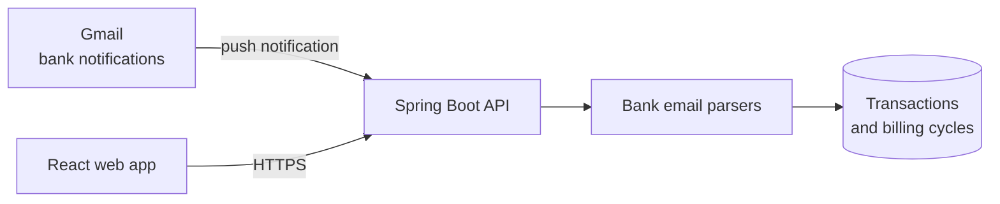
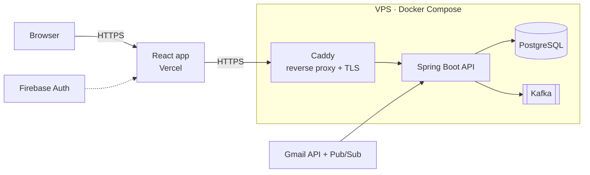

# Corte y Pago

**Corte y Pago** is a personal-finance app for Costa Rica that turns bank notification emails into a clear picture of your money: every SINPE Móvil transfer, every card purchase, and exactly how much and when you need to pay each credit card.

> The project is under active development.

## The problem

Costa Rican banks send an email for almost every movement: a SINPE Móvil you receive or send, a purchase with your debit or credit card. That information is already in your inbox, but it is scattered across hundreds of emails, from different banks, in different formats. Keeping track of what you spent, who paid you, and how much you owe on each credit card before its due date usually means spreadsheets, screenshots, or guessing.

## What Corte y Pago does

Corte y Pago connects to your Gmail with **read-only** access and listens for those bank notifications. Each email is read, recognized by bank and type, and turned into a structured transaction: amount, currency, counterparty or merchant, date, and the card that was used.

You register your cards using only their **last digits**, so card purchases are matched automatically. For credit cards you also set the cut-off date (*fecha de corte*) and the due date (*fecha de pago*); with that, Corte y Pago groups purchases into billing cycles and tells you the statement balance and how many days you have left to pay it, keeping colones and dollars separate, just like Costa Rican card statements do.

Emails that cannot be read, or purchases from a card you have not registered yet, are never lost: they wait in a review queue until you decide what to do with them.

## How it works



1. A bank sends you an email about a SINPE transfer or a card purchase.
2. Gmail notifies the API through Google Cloud Pub/Sub, and the API fetches only the new emails.
3. A parser for that bank extracts the transaction details.
4. The transaction is stored, matched to your card, and assigned to the right billing cycle.
5. The web app shows your transactions, your cards, and your upcoming payments.

## Architecture

The system is split into a web frontend and a backend API, deployed independently from this single repository.



The **API** is a Spring Boot application organized as a modular monolith: each business area (cards, transactions, email ingestion, parsing, billing cycles, review) lives in its own module with clear boundaries. Email processing is designed as an event-driven pipeline on Kafka, so raw emails can be reprocessed when a parser improves and failures go to a dead-letter queue instead of being lost.

The **frontend** is a React and TypeScript single-page app hosted on Vercel. It authenticates with Firebase, and the API validates every request's token and only accepts its owner.

In production, the API, database and message broker run with Docker Compose on a VPS. **Caddy** is the only service exposed to the internet: it terminates HTTPS with automatically renewed certificates and forwards traffic to the API over the internal Docker network.

## Security and privacy

Financial data deserves care, so security is part of the design rather than an afterthought. Gmail access is read-only, and bank emails are only accepted from known senders with a valid DKIM signature, which protects against forged notifications. Only the last digits of each card are ever stored. Secrets live exclusively in environment variables and never in the repository, and the database and broker are never reachable from the internet.

## Tech stack

| Area | Technologies |
|---|---|
| Backend | Java 21, Spring Boot 4, Spring Security, Spring Data JPA, Maven |
| Data and messaging | PostgreSQL, Flyway, Apache Kafka |
| Frontend | React, TypeScript, Vite, Tailwind CSS |
| Integrations | Gmail API, Google Cloud Pub/Sub, Firebase Authentication |
| Infrastructure | Docker Compose, Caddy, VPS, Vercel, GitHub Actions |
| Testing | JUnit 5, Testcontainers |

## Repository structure

```
corte-y-pago/
├── corteypago-api/   # Spring Boot backend
├── corteypago-web/   # React frontend
└── infra/            # Docker Compose and Caddy configuration for production
```

## Running locally

You need JDK 21, Node.js LTS and Docker.

```bash
# API → http://localhost:8080/api/hello
cd corteypago-api
./mvnw spring-boot:run

# Frontend → http://localhost:5173
cd corteypago-web
npm install
echo "VITE_API_URL=http://localhost:8080" > .env.local
npm run dev
```

## Author

**Kenneth López Porras** · [LinkedIn](https://www.linkedin.com/in/kennethlp) · [GitHub](https://github.com/kenneth260298)